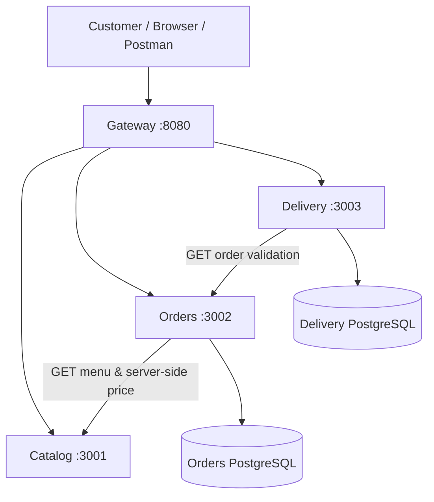

# Part 1: QuickBite Architecture & Collaboration

## Purpose and core use case
A food-ordering customer searches for restaurants, selects menu items, places a priced order, and requests delivery. The implementation is deliberately small enough to explain yet designed around independent deployable business capabilities.

## Service ownership
| Business capability | Owner | Commands | Queries | State |
|---|---|---|---|---|
| Restaurant/menu discovery | Catalog | Update menu (future) | GET `/restaurants`, GET `/restaurants/{id}/menu` | in-memory demo data |
| Order management & pricing | Orders | POST `/orders` | GET `/orders`, GET `/orders/{id}` | separate Orders database |
| Delivery tracking | Delivery | POST `/deliveries` | GET `/deliveries/{id}` | separate Delivery database |
| Public API entry and website | Gateway | forward writes | forward reads | no business data |

## Architecture (also see architecture_diagram.png)

There is **no cross-service database access**. Only Orders reads Orders DB; only Delivery reads Delivery DB. Catalog demo data stays in memory.

## Main operation sequence
1. User/browser calls `GET /api/catalog/restaurants` through Gateway.
2. User calls `GET /api/catalog/restaurants/r1/menu`.
3. User submits POST `/api/orders/orders`; Gateway forwards request to Orders.
4. Orders queries Catalog over internal HTTP and calculates prices using trusted menu prices, then stores the order in its own DB.
5. User submits POST `/api/deliveries/deliveries`.
6. Delivery calls Orders over HTTP to verify that the order exists, then stores delivery in its own DB. Unique orderId prevents duplicate creation.
7. User may query individual order and delivery records by ID.

## Design decisions
- REST/JSON synchronous HTTP: appropriate for a small academic demo; service failures return explicit 502/503 status. For high throughput, consider asynchronous events or message queues.
- Four independently deployable source directories: each includes main.py, requirements and Dockerfile; each must be published as a separate GitHub repo.
- Database-per-service: separate PostgreSQL StatefulSets with individual PVCs. SQLite local mode avoids a Docker prerequisite; Docker/Kubernetes modes use PostgreSQL.
- Scalability: stateless FastAPI processes, Kubernetes Service-based discovery, HPA for 2–10 application replicas, requests/limits and probes. HPA only operates when Metrics Server and sufficient CPU are present.
- Reliability: bounded HTTP timeouts, health/liveness checks, DB connection pooling, unique delivery constraint and graceful termination.
- Security: Pydantic input validation, server-side pricing, non-root images, local-only gateway exposure in Docker. The lab does not implement authentication, TLS, network policies or production secrets management.
- Scope gaps: Catalog has hard-coded data, no order cancellation, payment, transaction choreography, or HA PostgreSQL. The given PostgreSQL DB deployments have one instance each, **not** database failover.
